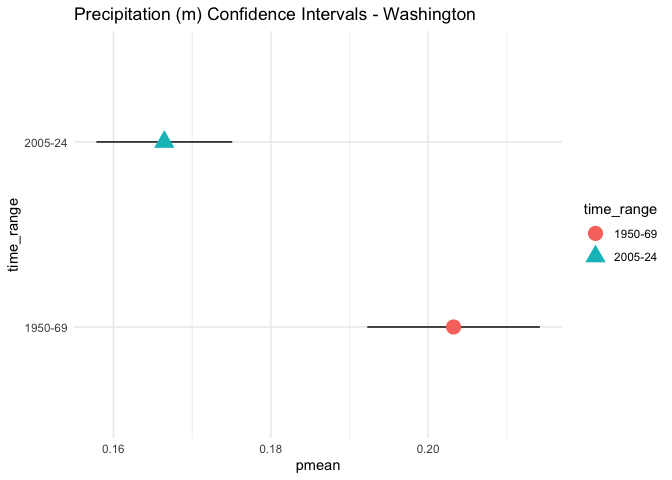
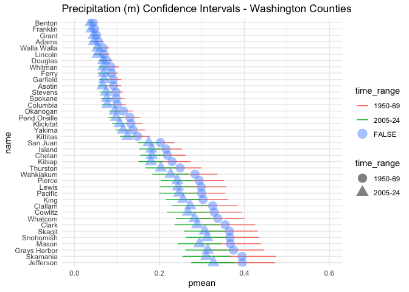
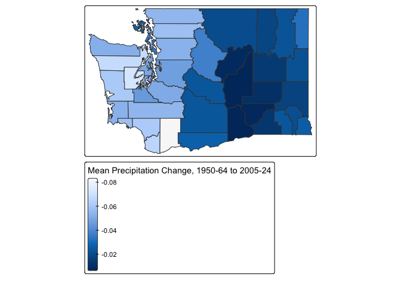

Geog 4/6300: Lab 3-Confidence intervals
================

## Confidence intervals

**Your name: Camryn Nelson**

**Overview:**

In this lab, we will create confidence intervals for January
precipitation in Washington during two time periods: 1950-1969 and
2005-2024. Using county-level precipitation data from the ERA5 dataset,
you will estimate statewide precipitation patterns, then examine
variation and change at the county level. We’ve summed the precipitation
in January for each county over two twenty year time periods: 1950-1969
and 2005-2024. You’ll be using those data to create confidence intervals
at a state and county level.

To load these data, load the csv file, which is included in the data
folder:

``` r
era5_data<-read_csv("data/precip_uswest_era5.csv")
```

This is a long format dataset including county identifiers, county
population, median household income, and poverty rate. Census figures
are based on the 2018-22 ACS. The last two columns (year, prcp_m,
time_range) give the year and total precipitation in meters from the
ERA5 NetCDF file, and two time ranges (1950-1969 and 2005-2024).

The script used to create this dataframe is also provided in this
repository (‘lab3_dataprep’), along with rasters of the yearly mean
total precipitation for Januaries in the two time periods of interest.

For this lab to be marked complete, it must demonstrate the following
learning standards:

- 11. Create effective data visualizations across multiple chart types
      (line, scatter, histogram, Q-Q plot), applying appropriate
      aesthetic choices such as color, grouping, and labeling. (Tasks 2
      and 5)
- 12. Produce and interpret confidence interval plots that enable visual
      comparison of means and uncertainty across groups or time periods.
      (Tasks 2, 3, 5, and 6)
- 13. Visualize spatial data using appropriate mapping tools, selecting
      suitable classification schemes and cartographic elements to
      support clear communication. (Task 7)
- 14. Arrange and present tabular results in a readable format
      appropriate for a technical document or report. (Tasks 1 and 4)
- 15. Use measures of central tendency and dispersion to describe the
      variables in tabular datasets (Tasks 1 and 4)
- 20. Explaining how evidence from a sample supports conclusions about a
      population while acknowledging sampling variability and
      uncertainty. (Tasks 3 and 6)
- 22. Construct and interpret confidence intervals, explaining how
      factors such as sample size and spatial scale affect the precision
      of an estimate. (Tasks 1, 3, 4 and 6)

# Part 1: Calculating statewide confidence intervals for Washington’s precipitation

In the first part of this lab, you’ll determine a confidence interval
for Washington’s precipitation for these two time periods. This can be
helpful in identifying whether precipitation has changed across the
state (e.g., whether the two confidence intervals overlap) using the
county data as your sample.

**Task 1** *Load the data and filter it to just include data for the
state of Washington. Then create a table showing mean precipitation,
standard deviation, number of observations (sample size), and
upper/lower confidence interval bounds for each of the two time periods
in the `time_range` field. Use `kable` to display the table when you are
done.*

``` r
#95% confidence 
z.score_upper=qnorm(0.975)
z.score_lower=qnorm(0.025)

washington <- era5_data %>%
  filter(st_name=="Washington") %>%
  group_by(time_range) %>%
  summarise(pmean=mean(prcp_m),
            psd=sd(prcp_m),
            count=n(),
            sterror=psd/sqrt(count)) %>%
  mutate(error=z.score_upper*sterror,
            cihigh = pmean-error,
            cilow = pmean+error)

kable(washington)
```

| time_range |     pmean |       psd | count |   sterror |     error |    cihigh |     cilow |
|:-----------|----------:|----------:|------:|----------:|----------:|----------:|----------:|
| 1950-69    | 0.2032239 | 0.1562948 |   780 | 0.0055963 | 0.0109685 | 0.1922554 | 0.2141923 |
| 2005-24    | 0.1664626 | 0.1230138 |   780 | 0.0044046 | 0.0086329 | 0.1578298 | 0.1750955 |

Using the code provided in class, create a ggplot graphic that
visualizes these two confidence intervals. You’ll want to use
`geom_point` and `geom_linerange` to do so. Use states as the y-axis and
mean precipitation as the x axis. Vary the color and position of the
dots and lines for the mean/CI by the `time_range` variable. Feel free
to also experiment with axis labels/themes to make the graph more
appealing and accessible.

**Task 2** *Create a ggplot graphic as described above to show the
confidence intervals for precipitation in Washington for each time
range.*

``` r
ggplot(washington) +
  geom_linerange(aes(xmin=cilow,xmax=cihigh,y=time_range,group=time_range)) +
  geom_point(aes(x=pmean,y=time_range, color=time_range, shape=time_range),size=5) +
  labs(title="Precipitation (m) Confidence Intervals - Washington") +
  theme_minimal()
```

<!-- -->

**Task 3** *Interpret your table and graph. What do they tell us about
the change in Washington’s precipitation during this time?*

There has been less precipitation in this time period, on average,
compared to 1950-69. We can say this with 95% confidence because the
confidence intervals of the two time periods do not overlap!

# Part 2: Analyzing county data in Washington.

In part 1, you ran a state level analysis. What if you wanted to
identify where populations might be negatively affected by precipitation
changes within a state? In this section, you’ll look at the changes in
precipitation **at county level** in Washington to

To start with, adapt your code from step 1 so that you create confidence
intervals for **counties** instead of states. After creating that
dataset, create another ggplot graph of those confidence intervals that
you can compare to the state level data in Task 2 to examine how
precipitation has changed across counties in Washington.

**Task 4** *Create a summary table for January precipitation in
Washington counties for both time periods. Use the same approach as in
Task 1, but calculate statistics for counties rather than the state as a
whole. Call the head of your table with `kable` when you are done.*

``` r
washington_cty <- era5_data %>%
  filter(st_name=="Washington") %>%
  group_by(time_range, cty_name) %>%
  summarise(pmean=mean(prcp_m),
            psd=sd(prcp_m),
            count=n(),
            sterror=psd/sqrt(count)) %>%
  mutate(error=z.score_lower*sterror,
            cihigh = pmean-error,
            cilow = pmean+error)
```

    ## `summarise()` has regrouped the output.
    ## ℹ Summaries were computed grouped by time_range and cty_name.
    ## ℹ Output is grouped by time_range.
    ## ℹ Use `summarise(.groups = "drop_last")` to silence this message.
    ## ℹ Use `summarise(.by = c(time_range, cty_name))` for per-operation grouping
    ##   (`?dplyr::dplyr_by`) instead.

``` r
kable(head(washington_cty))
```

| time_range | cty_name | pmean | psd | count | sterror | error | cihigh | cilow |
|:---|:---|---:|---:|---:|---:|---:|---:|---:|
| 1950-69 | Adams County, Washington | 0.0561916 | 0.0275746 | 20 | 0.0061659 | -0.0120849 | 0.0682765 | 0.0441067 |
| 1950-69 | Asotin County, Washington | 0.0917109 | 0.0412774 | 20 | 0.0092299 | -0.0180903 | 0.1098012 | 0.0736206 |
| 1950-69 | Benton County, Washington | 0.0439175 | 0.0199657 | 20 | 0.0044645 | -0.0087502 | 0.0526677 | 0.0351673 |
| 1950-69 | Chelan County, Washington | 0.2184237 | 0.0983827 | 20 | 0.0219991 | -0.0431173 | 0.2615410 | 0.1753063 |
| 1950-69 | Clallam County, Washington | 0.3252100 | 0.1331571 | 20 | 0.0297748 | -0.0583576 | 0.3835676 | 0.2668524 |
| 1950-69 | Clark County, Washington | 0.3545254 | 0.1621728 | 20 | 0.0362629 | -0.0710741 | 0.4255995 | 0.2834514 |

**Task 5** *Visualize the confidence intervals for the county-level data
you generated in task 4, using the same style as you did for Task 2
above. For an optional extra challenge, visually highlight the counties
where the confidence intervals between time periods do NOT overlap.*

``` r
overlap <- washington_cty %>%
  group_by(cty_name) %>%
  summarise(not = cihigh[time_range=="1950-69"] <
                  cilow[time_range=="2005-24"]) 

washington_cty_plot <- washington_cty %>%
  left_join(overlap, by = "cty_name") %>%
  separate(cty_name,into=c("name","state"),sep=" County, ") %>%
  mutate(name = reorder(name, -pmean))

ggplot(washington_cty_plot) +
  geom_linerange(aes(xmin=cilow,xmax=cihigh,y=name,color=time_range)) +
  geom_point(aes(x=pmean,y=name, color=not,shape=time_range),size=5, alpha=0.5) +
  labs(title="Precipitation (m) Confidence Intervals - Washington Counties") +
  scale_x_continuous(limits=c(0,0.6))+
  theme_minimal()
```

<!-- -->

**Task 6**: *Compare the size of the error terms for your county level
data to the error terms at state level that you calculated in Task 1.
Are they bigger or smaller? Explain why the formula you used for
calculating the error terms produced error terms of different sizes. How
is this difference visible in your ggplot graphs?*

Error terms are calculated by dividing by the square root of the sample
size, so error will decrease with higher sample size. The county sample
size (20) has greater error because it has a smaller sample than
statewide (780). You can see it in the graphs as the confidence
intervals; the statewide intervals are narrower than the countywide
ones.

**Task 7**: *Transform the county data from task 4 into wide format so
that the means for each time period are in the same row for each county.
Then calculate the change in precipitation between the time periods.
Join this table to the geopackage file that contains county boundaries
and census data, making sure that you only have Washington counties
included - use the geopackage `data/acsdata_cty_westreg.gpkg`. Then use
`tmap` to map out the difference in precipitation means across the two
time periods. Make sure the legend of this map is interpretable.*

``` r
gpkg = read_sf("data/acsdata_cty_westreg.gpkg")

washington_cty_wide <- washington_cty %>%
  select(cty_name, time_range, pmean) %>%
  pivot_wider(names_from=time_range,values_from=pmean) %>%
  mutate(deltap = `2005-24` - `1950-69`) 

bigdata <- gpkg %>%
  filter(st_name=="Washington") %>%
  left_join(washington_cty_wide, by="cty_name")

tm_shape(bigdata) +
  tm_polygons("deltap",
      fill.scale=tm_scale_continuous(),
      fill.legend=tm_legend(title="Mean Precipitation Change, 1950-64 to 2005-24")) 
```

<!-- -->

# Optional challenge section: Interpreting the implications of precipitation changes

Now that you’ve calculated these means and confidence intervals, let’s
identify who might be most affected by changes in precipitation. To see
who is affected, create a dummy variable that flags any counties with a
decline of 5 centimeters or more (0.05 meters) with a 1, labeling all
other counties with a 0. Use group_by and summarise to do the following:

- Count the total population in each of these two county groups.
- Calculate the mean value for median income and poverty rate in these
  two groups.

**Task 8** *Create a dummy variable for counties with a change of 0.05
meters or more between the time periods. Calculate how many people
currently live in these counties along with the mean value of median
income (medinc) and poverty rate (pov_pop_pct) for those areas.*

**Task 9** *Create a one paragraph summary of your results from tasks 7
and 8. What do you learn about how precipitation has changed in the last
70 years across the state of Washington? How would you describe the
population affected by large drops in precipitation based on your
results?*

{Your response here.}

Small multiples or multi-panel maps are often a helpful way to show
change over time. See this page for more information about how these are
created in `tmap`:

- <https://r-tmap.github.io/tmap/articles/basics_facets>

Using these tools, create a small multiples map of your precipitation
data for counties in a state of your choice for all 40 years in these
two time periods. This means you will have one figure with 40 individual
maps, all of the same state in different years. These maps should allow
easy comparison across years and should be clearly labeled so that they
could be interpreted by someone with no knowledge of this assignment.

In addition, describe two interesting trends you see in the figure you
created.

{Your response here.}

# Final submission stuff

**Disclosure of assistance:** Besides class materials, what other
sources of assistance did you use while completing this lab? These can
include input from classmates, relevant material identified through web
searches (e.g., Stack Overflow), or assistance from ChatGPT or other AI
tools. How did these sources support your own learning in completing
this lab?

I used the ?function and the Google AI overview for how to use tmap
since I forgot. They were helpful and I am now able to just use them to
remind me of things I know but need the syntax for.

**Lab reflection:** How do you feel about the work you did on this lab?
Was it easy, moderate, or hard? What are the biggest things you learned
by completing it?

It was good, I think this one was easier. I learned how to identify a
problem in the code and dig through to find the problem and fix it
(e.g. my confidence intervals being calculated backwards)
